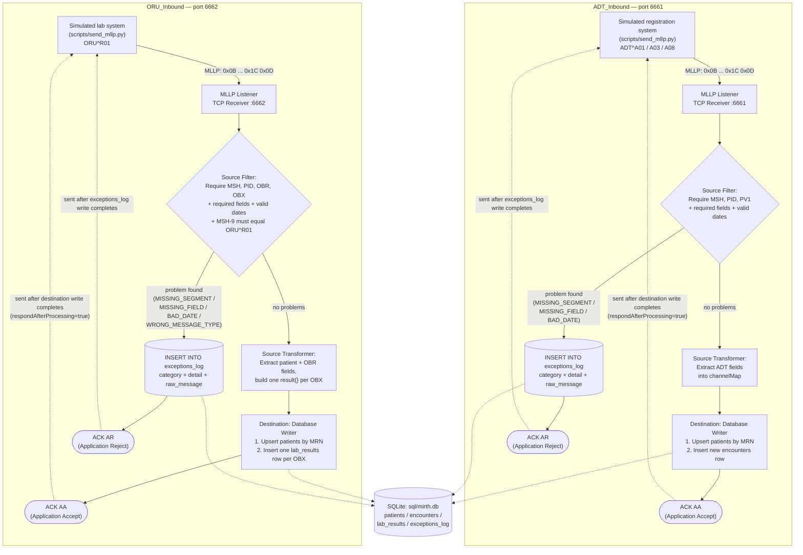

# Data Flow — ADT_Inbound and ORU_Inbound

Both channels share the same shape: MLLP listener → source filter (validate/reject) → source
transformer (extract fields) → JDBC database writer destination → SQLite. The ACK sent back to the
sender is generated automatically from the filter's accept/reject decision
(`responseVariable = Auto-generate (After source transformer)`), but is not actually transmitted
until the whole message — including the destination write — has finished processing
(`respondAfterProcessing = true`), per `channels/ADT_Inbound.xml` and `channels/ORU_Inbound.xml`.

## Notes on the diagram

- **Filter → `exceptions_log` branch**: both filters write the rejected-message row themselves
  (opening their own JDBC connection inside the JavaScript rule), independent of the destination
  connector. A logging failure is caught and does not change the reject decision — rejection always
  wins ("fail closed"). See `docs/interface-specification.md` §8.
- **Filter → transformer → destination path**: only runs for messages the filter accepts. The
  destination connector in both channels has its own (currently empty) filter/transformer slots —
  all accept/reject logic lives in the *source* filter, not the destination.
- **ACK timing**: because `respondAfterProcessing = true` on both source connectors, the sender
  does not get its ACK until Mirth has finished the full pipeline for that message — for an accepted
  message, that means waiting for the SQLite insert(s) to finish; for a rejected message, it means
  waiting for the `exceptions_log` insert to finish. The ACK *code* (`AA` vs `AR`) is decided purely
  by the filter step, not by whether the destination write itself succeeds — there is no observed
  path in this project that produces `AE` (see Known Limitations in
  `docs/interface-specification.md`).
- **No cross-channel linkage**: `ADT_Inbound` and `ORU_Inbound` write to the same SQLite file but
  never to each other — there is no connector or script that causes one channel's destination write
  to trigger the other. The shared `SQLite: sql/mirth.db` node above represents the common storage
  target, not a data-flow link between the two channels.
